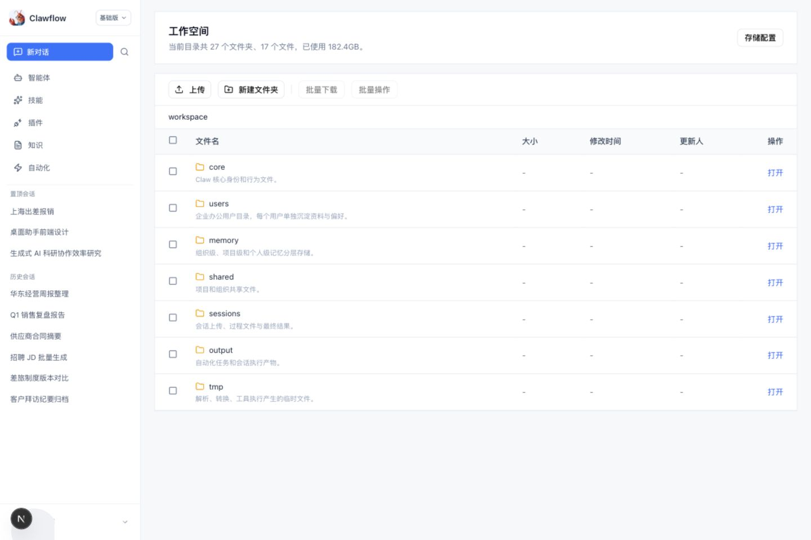
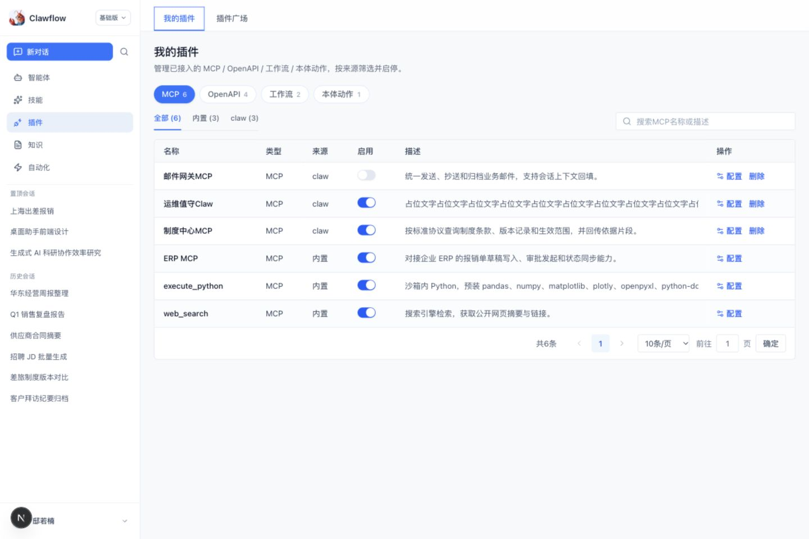
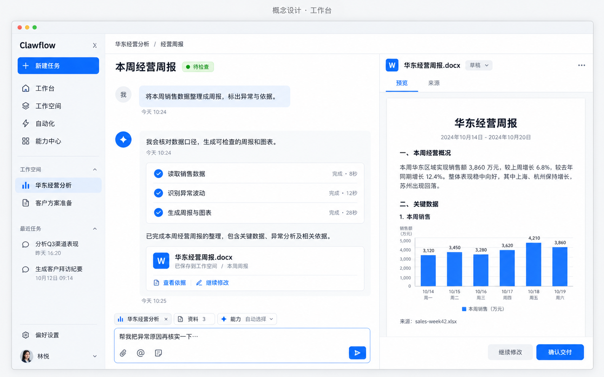
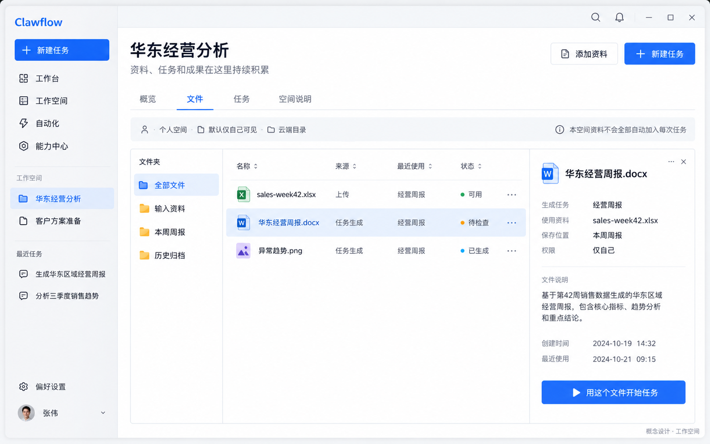
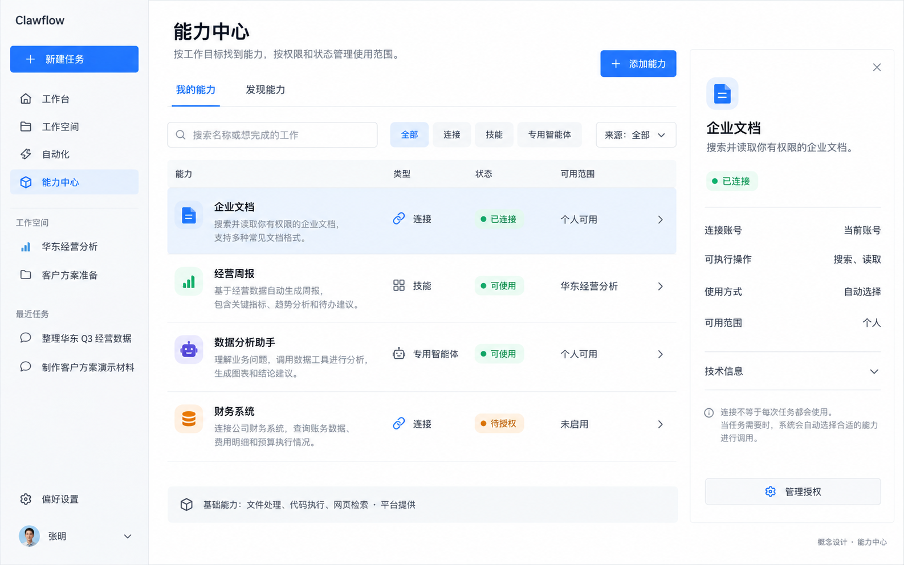

# Claw 使用端：从能力配置台走向个人工作台

> 产品形态与逻辑改造方案 · 2026-10-15 · 面向产品、设计与研发评审
> 当前证据：本地原型实查与代码；参考证据：官方产品文档；下文的目标形态、页面概念图与验收目标均为设计建议。

## 01 核心判断：把产品围绕工作组织起来

**建议将 Claw 定位为：围绕持续工作上下文，帮助个人执行任务、检查成果、积累资料的 AI 工作台。**

你提出的四个问题指向同一个结构性原因：当前使用端的信息架构更接近 Claw 的能力配置清单，用户需要先理解它有哪些部件，再设法组织自己的工作。改造应将主路径调整为：找到工作 → 说明目标与资料 → 执行与介入 → 检查产物 → 在同一上下文中继续。

这会改变三个主要组织中心：**工作台组织执行；工作空间组织上下文与成果；能力中心组织扩展与连接。** 自动化则是同一工作机制的持续触发方式。

| 你的问题 | 统一决策 | 用户感知的变化 |
| --- | --- | --- |
| 配置平铺，OpenAPI、MCP 等入口负担大 | 一个能力中心，按工作用途发现；协议进入连接详情与高级接入 | 先找“企业文档”“财务系统”，有需要再了解技术类型 |
| 内置与自定义分 Tab，但内置很少 | 一个默认列表，来源作为标签和筛选；核心基础能力单独摘要 | 无需猜测某个能力在哪个来源页 |
| 主导航与左下角的收纳规则不明 | 按操作对象与使用时机决定位置；账号菜单只处理身份 | 找资料、检查结果、修复任务依赖都有稳定位置 |
| 工作空间被藏起来 | 主导航常驻“工作空间”，侧栏可固定具体空间；任务中可见当前范围 | 明白任务在哪里做、读什么、结果存哪里 |

**优先改造一条完整工作链路，再逐步补齐资源包装和团队复用。** 只移动导航会改善可发现性，但不会自动形成工作台体验。

## 02 现状核对：四步看到结构性问题

本轮在本地 `/claw-client` 基础形态实查，采集了桌面 1440×960 截图；另观察了内嵌浏览器窄宽度状态。所有页面展示均为仓库的前端原型与 Mock，不代表线上后端能力或真实客户使用表现。

### 步骤 1 · 新对话首页：能直接开始，持续工作的入口弱

**判断：部分健康。** “新对话”清晰，历史会话也容易回到；主导航同时呈现智能体、技能、插件、知识、自动化，用户面对的是资源分类。首页没有展示当前工作范围、持续资料位置或最近产物。这个结论来自本轮首页截图，不能延伸为“所有历史会话都不支持产物”。

### 步骤 2 · 账号菜单：文件入口可达，但与身份设置混放

**判断：需要调整。** “文件管理”与“Claw 配置、接入渠道、我的账号”并列收在用户菜单。找工作资料需要进入身份入口，没有明确的对象归属。文件是日常工作的对象，应该拥有稳定的可见入口。

### 步骤 3 · 文件页：具备目录基础，组织方式偏运行环境

**判断：需要重构呈现。** 当前标题已经是“工作空间”，但主内容展示 `core / users / memory / shared / sessions / output / tmp`，首屏突出存储配置与容量。用户仍需要理解系统目录。改造可保留底层路径，通过业务索引呈现“我的资料、任务成果、工作文件夹”，将系统文件管理下沉。

### 步骤 4 · 插件页：已经归并接入类型，仍让协议与来源支配浏览

**判断：已有可复用基础。** 当前插件页实际上已经汇集 MCP、OpenAPI、工作流和本体动作；问题不是完全没有整合，而是需要先选协议/类型，再选“全部 / 内置 / claw”，随后才看到资源。“内置 / claw”是来源层筛选，并非独立的两套配置页；“我的插件 / 插件广场”才是生命周期层 Tab。这两种维度应区别处理。

当前 MCP 视图显示 3 条内置、3 条 Claw 来源数据。这是本地 Mock 数量，只说明该原型样本，不用来推断实际内置资源总量。用户给出的“实际只有两三个”是本次设计约束。

**可见的可访问性与适配风险：** 来源 `claw` 含义不明确；状态主要通过开关呈现，难以表达“未授权/失效/不可用于本次任务”。窄视口文件表格出现明显换行与拥挤，应采用收起侧栏、列裁剪或表格内部滚动。键盘顺序、读屏、焦点回退与对比度仍需专项验证，本轮不作合规结论。

## 03 参考产品：借鉴组织原则，保留 Claw 的业务边界

以下依据截至本轮访问的官方说明，属于文档研究；未在竞品登录态下逐屏实测，不据此断言每个客户端的精确导航位置。

| 参考 | 官方证据支持的做法 | 对 Claw 的启发 |
| --- | --- | --- |
| Claude Cowork | 选择工作文件夹，使读取材料与保存成果围绕工作位置展开 | 把工作范围与结果位置放进任务主路径 |
| Cowork 插件 | 角色能力可以由技能和连接组成一个安装单元 | 能力可以按目标打包；安装与连接状态仍要分别表达 |
| WorkBuddy | 插件系统覆盖 Skill、MCP、Hook、Agent、Rule | 一个扩展入口可以容纳不同能力构件，类型留作解释 |
| OpenAI 官方桌面文档 | 跨项目/聊天组织工作，同一工作区检查文件和持续推进长任务 | 主界面需要支持监督工作与检查产物 |
| OpenAI 插件架构 | 插件可包含技能、MCP 或二者组合 | 技能与工具有互补角色，统一分发不等于对象合并 |

参考：[Cowork 工作文件夹](https://academy.claude.com/tutorials/get-started-in-claude-cowork-in-three-steps)、[Cowork 插件定制](https://academy.claude.com/tutorials/how-to-customize-plugins-in-cowork)、[WorkBuddy 插件系统](https://www.codebuddy.cn/docs/workbuddy/Plugins)、[OpenAI 桌面文档](https://learn.chatgpt.com/docs/app)、[OpenAI 插件架构](https://developers.openai.com/plugins/concepts/plugins)。OpenAI 原 Codex app 文档地址本轮重定向到桌面文档，故不将页面内容一概视为 Codex 独有能力。

**由此形成的设计推论：** 工作位置、持续任务、成果检查和用途驱动的扩展值得借鉴。没有证据要求 Claw 一定复制竞品的云盘、侧栏数量或全部插件类型；本方案不把“趋势”当成用户需求已被验证的替代品。

## 04 先明确用户每天在做什么

| 工作情境 | 用户真正要完成的事 | 必须解决的产品问题 |
| --- | --- | --- |
| 临时处理 | 上传一个文件，快速比较、整理、输出 | 无需创建空间或安装整套能力，直接开始；产物可找回 |
| 持续工作 | 每周用更新的数据做经营周报 | 同一位置复用资料与说明；每次任务的具体输入可追溯 |
| 定时委托 | 每周一整理新资料，等待我检查 | 自动化引用明确范围与能力；运行记录、失败和结果可回到任务 |

初期优先面向实际做资料分析、文档产出和业务跟进的个人使用者。平台管理员、插件开发者和智能体构建者的操作继续在管控端完成。个人使用端提供选择、连接、轻量导入与必要的高级入口。

临时工作仍允许不指定命名空间：先存入“个人默认空间”，需要长期积累时再归档到命名空间。用户不应先完成一串配置才能发出第一条任务。

## 05 统一对象模型：工作在哪里、执行什么、依靠什么

### 三条互相连接的主线

| 主线 | 从上到下的关系 | 责任 |
| --- | --- | --- |
| 工作与上下文 | 个人默认空间 / 命名工作空间 → 任务（以会话承载）→ 多次执行 → 文件与产物 | 管理目标、资料范围、工作过程与保存位置 |
| 可复用能力 | 技能 / 连接 / 专用智能体 → 被任务选择或自动匹配 → 执行中实际调用 | 解释做法、提供访问与动作、委托专业处理 |
| 企业治理 | 组织身份与项目权限 → 约束资源可用性与数据访问 → 作用于每次执行 | 保留既有权限、配额、发布和资源管理边界 |

**工作空间是一组持续工作上下文，文件是其中一部分。** 一个命名空间至少包含目标说明、文件与资料源索引、任务及成果索引；可进一步保存该工作的输出约定和常用能力引用。

**“任务”是用户工作单元，“会话”是交互容器，“执行”是一次运行。** P0 可在现有 `sessionId` 上呈现任务标题和状态，不额外制造一个无法同步的新任务表。重试或继续会产生新执行，仍回到原任务。多人协作中的 Issue 是需要跟踪/验收的事项，不能因为个人端改名就与所有聊天强行一一对应。

**基础能力、扩展能力、执行环境分别建模。** 文件操作、代码执行等由平台提供的基础能力，在能力中心显示摘要及可用性；沙箱、存储卷等环境配置由平台治理。用户连接的业务系统和导入的技能有独立生命周期。

### Workspace 命名与已有 Project 的衔接

仓库历史方案中同时出现组织层 Workspace、平台 Project 和使用端协作 Project，后续文档还有调整。此次不宣布这些历史对象已完全统一。

| 界面名称 | 本次建议含义 | 与现有模型的衔接 |
| --- | --- | --- |
| 组织 / 所属组织 | 身份、策略与资源访问来源 | 保持组织 Workspace 的权限边界，不改名为个人工作目录 |
| 工作空间 | 用户可进入的持续工作上下文 | 使用独立 WorkContext 概念或现有可承载对象映射；技术命名待 PRD 冻结 |
| 项目工作空间 | 在协作 Project 中工作的入口 | 关联已有 `projectId`，不再在 Project 下强加一个必建空间层 |
| 文件位置 | 云端目录、接入的本地目录或受控资料源 | 是工作空间的数据位置，不等于组织或项目权限 |

个人创建空间不要求创建组织项目；进入协作项目时，可以直接以该 Project 的工作空间视图工作。对现有 Project Context 仅支持 GitHub/Local Directory 的契约，云端资料集合是本次提出的扩展需求，不能当作现成能力。

## 06 目标信息架构：四个工作入口，一个设置入口

### 主导航与内容层级

| 层级 | 入口 | 内容 |
| --- | --- | --- |
| 开始动作 | 新建任务 | 在当前空间开始，支持切换到个人默认空间 |
| 全局目的地 1 | 工作台 | 继续工作、待我处理、近期任务；进入任务后的执行与产物检查 |
| 全局目的地 2 | 工作空间 | 全部可用空间索引、个人默认空间、最近空间与授权项目空间 |
| 全局目的地 3 | 自动化 | 已委托的持续工作、触发安排、运行记录 |
| 全局目的地 4 | 能力中心 | 我的能力、发现能力；连接、技能、专用智能体 |
| 个人级设置 | 偏好设置 | 常驻侧栏底部，含工作偏好、默认模型、通知及高级选项 |
| 身份入口 | 头像菜单 | 我的账号、组织切换（确有多组织时）、退出 |

“偏好设置”与四个主要业务入口分区，保留常驻位置。“新建任务”是动作，不作为与“工作台”竞争的另一首页。

侧栏中部承载“固定的工作空间”和“最近任务”。它们是快捷入口：点击工作空间主导航看全部空间，点击“华东经营分析”进入具体空间。最近任务只显示一份，空间内任务列表是当前范围的内容视图，不再叠加“最近/全部/我的工作/空间总览”等平行主入口。

首次进入展示工作台；返回时优先恢复上次可访问任务。无工作历史时，工作台只给一个任务输入框和“添加资料 / 选择工作空间”，用少量示例帮助开始。已有任务时突出继续工作与待检查结果，不做大面积运营仪表盘。

### 三栏空间分工

| 区域 | 职责 | 展开规则 |
| --- | --- | --- |
| 左栏 | 去哪里工作、回到哪个任务 | 稳定存在；窄宽度可收起，当前空间仍在任务头部可见 |
| 中栏 | 当前目标、执行过程、人机交互 | 始终是主区；计划、进度、阻塞、结果按需展开 |
| 右栏 | 文件预览、成果检查、资料与能力范围 | 打开产物时出现；小宽度切换为覆盖面板或独立检查页 |

桌面可先以左栏约 220–240px、其余主区弹性分配为设计起点。1440px 检查三栏，1024px 采用两栏或收起预览，窄至 768px 以下以主任务单栏为先。这些是需要验证的布局规则，不是竞品尺寸结论。

## 07 导航收纳规则：由对象、时机和职责决定

**是否外显不取决于它“是不是配置”，而取决于用户完成工作时是否必须找到它。**

| 判断问题 | 放在哪里 | 示例 |
| --- | --- | --- |
| 是否是每天切换的工作对象或长期工作集合？ | 主导航 / 固定空间 | 工作台、工作空间、自动化 |
| 是否跨任务复用，且用户需要主动发现或修复？ | 能力中心 | 企业文档连接、技能、专用智能体 |
| 是否只影响当前空间？ | 空间详情 / 空间说明 | 目标、输出约定、默认资料范围、常用能力引用 |
| 是否只影响当前任务或执行？ | 任务头部 / 输入区 / 检查面板 | 本次资料、允许动作、模型临时覆盖、输出位置 |
| 是否是个人默认行为和显示偏好？ | 常驻的偏好设置 | 默认模型、个人说明、通知、外观 |
| 是否是身份关系？ | 头像菜单 | 账号、组织切换、退出 |
| 是否是运行环境或治理？ | 管控端；使用端给状态和定位入口 | 存储卷、沙箱配额、主备模型策略、平台发布审批 |

低频不等于隐藏；“连接失效”虽然低频，却会阻断工作，应在任务阻塞处直接提供修复链接。高级参数可折叠，但入口位置必须符合对象归属。

## 08 工作台：让委托、执行、检查与继续形成闭环

> 图为 AI 生成的布局概念，示例资料与状态均为演示；精确控件、文案与状态以本方案正文和后续设计稿为准。

三张概念图侧栏中部的“工作空间”分组标题，落地时统一命名为“固定空间”，与上方“工作空间”全量索引入口区分。图中的示例日期、头像、数字和交付状态不参与方案验收。

### 开始任务时只让用户作必要决定

输入目标后，用户可以直接执行。输入区持续可见：当前工作空间、已选资料摘要、能力策略、产物保存位置。模型是次级选项，以“默认模型”呈现，主备链和温度等参数进入偏好/高级配置。

“资料 3 项”必须能打开查看实际对象及访问方式；“自动选择能力”必须能看到本次允许的能力及排除原因，不能只给一个无法解释的魔法开关。缺少连接时在当前任务提出相关补齐动作，成功后回到原任务继续。

### 执行时显示可行动的状态

| 状态 | 用户需要看到 | 主要动作 |
| --- | --- | --- |
| 执行中 | 当前步骤、已完成事项、实际使用的资料/能力 | 追加要求、停止 |
| 待授权 / 待补资料 | 具体缺口、影响的步骤、可继续的部分 | 连接、选择文件、修改范围 |
| 部分完成 / 失败 | 已保存的结果、失败步骤及原因 | 从失败处重试、缩小任务 |
| 已生成 | 可打开的产物、来源、保存位置 | 检查、继续修改 |
| 已交付（可选业务状态） | 用户已确认的交付结果 | 再开后续工作、归档 |

执行完成与业务验收分开。普通问答可直接结束；需要正式交付的文档任务提供“确认交付”，不强迫每个聊天都走审批。停止执行保留已生成文件与记录，并清楚标记是否完整。

### 产物应成为可操作的工作对象

对话中的产物条目与右侧预览都指向同一文件对象，至少支持预览/下载、继续修改、查看生成任务与资料来源、定位到空间。预览失败时提供下载和失败原因。对已有文件的改动要能区分原件与新输出，覆盖策略由用户工作约定决定；正式版本管理可后续建设，P0 不伪造已有完整版本历史。

## 09 工作空间：资料、持续上下文与成果的聚合处

### 空间应提供四个明确视图

| 视图 | 主要内容 | 用户价值 |
| --- | --- | --- |
| 概览 | 目标、继续工作、最近成果、待处理 | 回来时知道进展与下一步 |
| 文件 | 上传资料、任务输出、目录及外部引用 | 找到可用的工作材料和结果 |
| 任务 | 在本空间发生的任务及状态 | 继续或追溯处理过程 |
| 空间说明 | 工作目标、术语、输出约定、默认范围 | 减少重复交代工作背景 |

P0 可以先交付文件与任务两个核心视图，再补概览；不能因页面图有四个 Tab 就假定第一期全部可用。所有文件与任务汇聚以索引和关系实现，避免用户完成任务后再手工“上传到工作空间”。

### 四类内容的边界

| 内容 | 放置方式 | 进入任务的方式 |
| --- | --- | --- |
| 工作文件 | 空间文件索引；保持稳定文件 ID 与真实存储路径 | 用户明确选择，或在已允许范围内检索读取 |
| 企业知识库/数据库 | 资料源引用，不假装成已复制到云盘的文件 | 通过相应连接按权限检索，保留来源 |
| 空间说明 | 可编辑的目标与约定，有更新时间 | 默认作为该空间任务的轻量说明；可在任务中查看 |
| 个人偏好与记忆 | 个人偏好单独管理；可采纳的工作记忆有来源和范围 | 不自动把所有历史聊天塞进每次上下文 |

**“空间可访问”≠“本次已提供给模型”≠“模型实际读取过”。** 界面分别说明可检索范围、用户选中的资料和实际使用证据。大文件显示元数据并按需读取；大量资料使用检索和引用，避免所有文件全文默认加载。

### 文件生命周期与来源

上传/生成后先登记对象，再完成可用性检查或索引。列表清楚区分“处理中、可用、失败、来源失联、权限已撤销”；只有真实完成才显示“可检索”。文件详情保留输入资料、生成任务、生成执行、保存位置和可见范围。来源关系只有执行过程确实记录到时才声明，不能凭文件名自动认定血缘。

原始 `core / memory / tmp` 等运行目录继续服务系统；使用端默认业务视图不展示它们。调试需要时进入“高级 → 运行文件”，普通用户不从这里整理业务资料。存储用量在空间信息中可查看，卷配置返回管控端。

### 本地、云端与协作边界

当前云端沙箱/目录能力应准确标识为云端；本地文件夹接入只有在桌面组件或受支持代理可达时才出现，不能把浏览器上传描述为持续本地目录访问。外部文档引用保留原权限与链接；断开连接后不再假定能读取，已生成的本地结果按其自身权限保留。

项目空间延续原项目成员和会话访问范围。项目文件索引可以汇聚产物，但索引可见不等于原始聊天和文件内容对所有项目成员开放。个人结果移入共享项目时需要明确可见范围；空间归档不删除文件，删除文件需展示依赖任务和可恢复机制。P0 优先归档/移除引用，不做静默删除与路径搬迁。

## 10 能力中心：统一入口，多种对象，各自保留职责

**建议对外叫“能力中心”。** 这个名称同时容纳连接、技能和专用智能体；其内部默认“我的能力”，另有次级“发现能力”。当供给很少时，“发现”采用紧凑推荐列表和“导入/接入”，不做空旷大市场。

| 一级类型 | 用户理解 | 包含或映射的现有内容 |
| --- | --- | --- |
| 连接 | 让 Claw 访问某个系统或资料源，执行允许的动作 | MCP、OpenAPI、已发布工作流入口、本体动作服务、知识库/数据库连接 |
| 技能 | 一套可以重复采用的工作方法与输出约定 | 现有 Skill、带依赖的业务操作方法 |
| 专用智能体 | 把特定工作交给具有固定能力的助手 | 已发布单智能体或多智能体作为一个整体；个人 Claw 继续是默认执行者 |

“工作流”若是可调用的已发布动作，放在连接之下；若被包装为一套工作方法，可被技能引用。不要把编排器直接嵌进个人使用端。本体对象、术语库是资料源；本体动作是可调用动作，两者的使用路径不同。连接详情应解释到底提供读取还是写入。

### 五个维度，各有固定位置

| 维度 | 建议位置 | 原因 |
| --- | --- | --- |
| 类型：连接/技能/专用智能体 | 类型筛选或紧凑分组 | 对应不同用途与管理动作 |
| 用途：文档/分析/业务协作 | 搜索与发现页分类 | 用户通常按想完成的工作寻找 |
| 来源：平台提供/组织共享/我添加 | 行内标签和可选筛选 | 来源不决定浏览主路径 |
| 状态：可用/待授权/失效/停用 | 行内明确文字、异常优先排序 | 用户需要知道能否使用及如何恢复 |
| 技术：MCP/OpenAPI/工作流等 | 详情 → 技术信息；高级筛选 | 保留诊断与接入需要，减少普通浏览负担 |

现有“内置”标签应保留原始来源字段，同时新增“能否删除、能否停用、谁在维护”等独立属性。平台提供不等于强制开启；不可删除不等于不可暂停。`claw` 在界面改为“我添加”或真实来源名，不能简单把所有 `origin=claw` 推断成用户原创。

### 基础能力很少时怎么呈现

文件处理、代码执行、网页检索等基础能力用一块简洁摘要展示“平台提供、当前可用/受限、限制原因”。需要控制网络检索或代码执行时提供对应策略，不能隐藏事实上的用户控制。不要为两三个基础能力保留独立来源 Tab，也不要把基础能力包装成需要用户重复安装的商品。

### 添加能力的路径

“添加能力”先呈现按名称/用途搜索和轻量发现。另一入口“高级接入”再选择 MCP、OpenAPI、工作流/本体动作或导入 Skill。普通使用者接入已发布能力；开发、调试、发布仍回到管控端。

一份资源在“我的能力、发现能力、空间引用、任务选择”中始终使用同一稳定 ID。发现页添加后更新原条目的状态，避免再复制一份无法同步的资源。

## 11 安装、连接、授权与使用：让状态能够解释

一个总开关无法表达全部资源状态。建议至少拆成三个相互独立的层次，再计算是否可用于当前任务。

| 层次 | 状态示例 | 表达的问题 |
| --- | --- | --- |
| 获取/引用 | 可发现、已添加、已移除 | 用户是否拥有这份能力引用 |
| 配置与健康 | 无需连接、未连接、连接中、已连接、授权过期、异常 | 依赖是否准备好，连接是否有效 |
| 使用策略 | 启用/停用；允许的空间与动作 | 用户/组织是否允许在某个范围使用 |

技能可能无需登录，但依赖某个连接；一个系统可能绑定多个账号，必须显示本次选用的账号。专用智能体有发布版本、可见范围与环境要求，无法仅由“已添加”推断可执行。

**本次可用范围由：组织策略 ∩ 用户授权 ∩ 空间允许范围 ∩ 本次任务选择 ∩ 当前执行环境共同约束。** 技能匹配只影响“选择哪个方法”，不能扩大文件或工具权限。

| 场景 | 用户看到什么 | 恢复路径 |
| --- | --- | --- |
| 安装了技能但依赖未连接 | 经营周报 · 需连接企业文档 | 在详情或任务中补齐连接，返回原任务 |
| 已连接，但不允许用于此空间 | 财务系统 · 当前空间不可用 | 查看限制来源，切换允许的工作范围或申请可用权限 |
| 授权过期 | 企业文档 · 需要重新连接 | 重连后重新检查，保留原任务输入与已完成结果 |
| 能力停用或被移除 | 历史任务仍保留曾用能力和版本 | 新执行提示缺失依赖，不悄悄替换为别的系统 |
| 包更新后需要新增权限 | 更新可用 · 需检查新增权限 | 说明变更，采用更新后再执行，不继承未授予动作 |

写入、发送、删除等动作按照现有平台策略和用户对任务的明确委托执行。组织授权不能被个人覆盖；需要确认的动作在具体执行点呈现对象与后果。这里是产品状态与治理衔接要求，不意味着给每次只读工具调用新增审批。

每次执行保留必要的配置版本与输入引用；权限在实际读取/动作时继续校验，快照不应使已撤销权限继续生效。历史回看显示当时使用的资料与能力，重跑采用当前有效权限并提示关键差异。

## 12 技能、专用智能体、知识和记忆分别放在哪里

| 对象 | 默认体验 | 管理入口 | 需要避免的混淆 |
| --- | --- | --- | --- |
| 个人 Claw | 默认接收用户任务的执行者 | 偏好设置中管理个人说明与默认模型 | 不要求每次先到广场挑自己 |
| 技能 | 自动按任务匹配，也可明确指定；展示实际采用的方法 | 能力中心 → 技能 | 启用技能不等于它在所有任务都被调用 |
| 专用智能体 | 任务内按需要委托；显式展示委托对象和结果 | 能力中心 → 专用智能体 | 不把多智能体内部子节点铺满主导航 |
| 知识库/术语库/本体资料 | 作为可引用的资料源，按权限检索 | 能力中心管理接入；工作空间管理引用 | 连接可用不等于本次全量加载 |
| 数据库 | 展示可查询范围、账号和只读/可写动作 | 连接详情；空间引用特定数据范围 | 数据库不是一个能直接上传的文件夹 |
| 个人偏好 | 默认写作方式、沟通习惯 | 偏好设置 | 与当前工作专属要求分开 |
| 空间说明 | 工作目标、术语和输出要求 | 空间说明 | 避免成为跨工作串用的全局提示词 |
| 可采纳的记忆 | 有来源、范围和可编辑内容 | 对应个人/空间的记忆管理 | 历史聊天、推断和候选不自动升级成事实 |

P0 不新增复杂记忆运营页：先明确个人说明与空间说明的边界。自动提炼记忆、版本冲突和跨空间复用放入后续机制设计。

## 13 自动化与渠道：用相同任务机制承接持续委托

### 自动化是触发方式，不是另一套执行产品

用户可以在完成一次周报后选择“设为每周执行”，复用已确认的任务目标、资料选择规则、能力要求和产物位置。自动化保留触发配置，每次触发生成可追踪的执行并关联任务，结果进入原工作空间。

至少显示：时区、下次运行时间、所用工作空间、输入范围规则、最近结果、失败原因、暂停/恢复。个人默认空间、云端空间与仅本地可达空间的可运行条件不同；离线或权限失效时应报告阻塞，不把“已创建计划”当作“保证后台执行”。

设置自动化时区默认采用用户时区；示例为 Asia/Singapore。运行中暂停只阻止后续触发，停止当前执行是单独动作。对重叠触发使用明确的排队/跳过策略，对同一执行重试保持幂等，避免重复输出或重复业务动作。

“待我处理”首先是工作台内的筛选视图，汇聚授权、缺资料、失败、待检查；本期不额外增加一个与工作台平行的个人 Inbox 主入口。后续多人协作可与已有全局 Inbox 对接。

### 同一个外部系统可以有两种不同关系

| 关系 | 例子 | 入口与职责 |
| --- | --- | --- |
| Claw 访问服务 | 搜索企业文档、读取业务数据 | 能力中心 → 连接，管理账号、动作和使用范围 |
| 外部渠道访问 Claw | 从飞书/企微/钉钉给 Claw 发任务或接收结果 | 偏好设置 → 消息与渠道，管理接收身份、会话路由和通知 |

可在同一个系统详情相互链接，但分别表达状态。接通消息机器人不应自动视为拥有整套企业文档权限；连接了文档系统也不等于可以从外部聊天启动 Claw。渠道创建的任务仍回到相同任务、工作空间与执行记录。

## 14 贯穿场景：经营周报从第一次使用到持续运行

| 步骤 | 用户操作 | 系统行为 | 关键反馈 |
| --- | --- | --- | --- |
| 1 | 在工作台上传销售表，输入“生成本周经营周报” | 在个人默认空间创建任务及文件索引 | 任务已开始，当前使用的文件可查看 |
| 2 | 指定“华东经营分析”，或先完成再归档 | 绑定或移动任务归属引用，检查范围变化 | 明确资料与产物以后在哪里继续 |
| 3 | Claw 发现需查询制度，用户选择已可用的企业文档连接 | 在原任务补齐依赖，按范围读取 | 解释为何需要此连接，显示账号与操作范围 |
| 4 | 执行分析并生成文档、图表 | 记录实际输入与调用，登记产物 | 文档可预览；结果、来源和保存位置可检查 |
| 5 | 用户要求修改，确认本轮交付 | 新执行关联原任务，保留必要来源 | 可区别初稿、后续输出与交付状态 |
| 6 | 将此工作设为每周一运行 | 保存目标、资料匹配规则、时区和输出位置 | 预告下次运行，说明依赖的可达条件 |
| 7 | 下一次完成或受阻 | 更新任务/执行记录，汇总到待处理 | 从同一入口检查结果、修复依赖或重试 |

临时处理只走第 1、4、5 步即可。持续工作才逐步引入命名空间、能力复用与自动化。这样既保留轻量入口，也形成越用越有积累的工作机制。

## 15 旧入口与配置的完整迁移表

| 当前内容 | 新归属 | 迁移动作与注意事项 |
| --- | --- | --- |
| 新对话、历史会话 | 新建任务、最近任务 / 工作台 | 保留 `sessionId` 和深链；已有对话可继续，无需先补空间 |
| 智能体广场 | 能力中心 → 专用智能体 / 发现 | 保留已发布智能体 ID；默认个人 Claw 不作为待安装项 |
| 技能 | 能力中心 → 技能 | 复用 Skill 数据；来源改为属性，保留权限和启停状态 |
| 插件中的 MCP/OpenAPI | 能力中心 → 连接 | 保留原类型和接口契约，默认按系统/用途展示 |
| 工作流 | 连接中的已发布动作 | 编排、调试、发布在管控端；技能可引用该动作 |
| 本体动作 | 连接中的受控业务动作 | 动作权限与本体对象资料引用分开 |
| 知识库、数据库、本体对象、术语库 | 能力中心管理接入；空间管理资料源引用 | 同一来源 ID 多处引用；不复制一套独立数据 |
| 文件管理 / 工作空间 | 工作空间 → 文件 | 先做索引与业务视图，不直接搬迁实际目录 |
| `core / memory / tmp` | 高级运行文件 / 平台运维 | 普通文件视图不展示；不删除底层内容 |
| 自动化 | 常驻自动化入口 | 复用任务/执行历史；补齐工作范围与结果位置 |
| Claw 配置中的 Agent.md | 偏好设置 → 个人说明 | 保留高级原文编辑；空间要求单独承载 |
| 主模型、参数、回退模型 | 默认模型放个人偏好；回退策略放平台高级治理 | 保留现有值；先只读呈现受管策略，不静默重置 |
| 存储配置 | 管控端；使用端空间信息显示用量/状态 | 从工作资料主路径中移出，保留合法运维入口 |
| 接入渠道 | 偏好设置 → 消息与渠道 | 保留现有凭据和路由标识，不推断为业务连接授权 |
| 我的账号 | 头像菜单 | 保留账号身份信息和退出 |
| 基础形态 / 项目协作形态切换 | 逐步整合为个人/项目上下文入口 | P0 保留切换与现有路由；模型及验收完成后再统一外壳 |

### 迁移顺序与回退

第一步建立旧入口到新入口的路由映射和稳定资源 ID，允许切回旧外壳；第二步做新视图与上下文引用，保留底层数据；第三步在完成验证后迁移默认入口。旧链接至少定位到对应任务/资源，不能全部回落到首页。

启停、授权、账号、资源来源、目录权限与任务归属必须逐项读回校验；未知来源保持未知。没有空间归属的历史会话进入个人默认空间索引，不能自动根据标题分配到共享项目。出问题可切回旧外壳，停止新映射写入并保留新增记录；具体数据写入与回退脚本在实施 PRD 中定义。

## 16 分期实施：先完成能工作的闭环

| 阶段 | 交付重点 | 明确的完成边界 |
| --- | --- | --- |
| P0 · 结构与最小工作闭环 | 新导航；工作空间外显；能力统一入口与来源属性；当前任务范围；文件输出预览与定位；旧链接兼容 | 从上传资料到产物检查与找回可以贯通；状态有真实依据 |
| P1 · 持续工作 | 命名空间说明/任务索引；资料源引用；依赖修复后继续；自动化复用任务；历史执行来源 | 同一工作可跨任务持续推进，断连、失权、失败均能恢复 |
| P2 · 能力包装与协作复用 | 技能+连接+智能体能力包；版本与依赖检查；组织分发；项目空间完整衔接 | 复用不扩大权限；个人与项目上下文切换可解释 |

这是按依赖关系建议的顺序，不是工期承诺。P0 的资料预览、对象存储/本地访问、执行事件与权限检查是否已有可复用服务，仍需研发确认。该仓库是前端原型，不能把现有按钮和 Mock 当作生产实现。

### 实施依赖

| 产品能力 | 需要的工程契约 |
| --- | --- |
| 工作空间业务视图 | WorkContext 与现有 Project/目录的映射；文件与任务索引；访问校验 |
| 任务和产物闭环 | session/run/file 稳定关系；执行状态事件；产物登记与预览 |
| 能力中心 | 资源统一索引；类型适配器；账号绑定；健康与依赖状态 |
| 任务范围解释 | 本次选择、可检索边界、实际使用证据分别记录 |
| 自动化持续委托 | 时区、调度、可达环境、幂等、失败恢复及结果回链 |

建议沿现有 `components/my-claw`、`components/claw-client` 与 Mock 类型逐步演进。`plugins.ts` 已有协议类型和来源字段可复用；不要为了新的使用端导航同步重构平台所有资源管理页。

## 17 验收：验证工作成功，而不仅是导航变短

| 验收情境 | 应观察到的结果 |
| --- | --- |
| 第一次使用，无能力配置 | 能直接上传/输入目标启动支持的工作；依赖不足明确解释 |
| 只有两三个平台能力 | 无独立“内置”大页，基础可用状态仍可查看与控制 |
| 想找“企业文档”但不知道 MCP | 按用途/名称即可找到，详情仍能查到接入协议 |
| 安装技能但未连接依赖 | 明确显示待连接，补齐后回到原任务，不丢输入 |
| 当前空间没有授权 | 不读取；显示实际限制和合法恢复路径 |
| 空间有数百个文件 | 能说明可检索范围与实际输入，不全量加载 |
| 同名文件或多个账号 | 使用稳定 ID/路径/账号区分，不凭名称混用 |
| 生成报告后关闭会话 | 能从工作空间找到报告并回到生成任务与来源 |
| 执行完成但尚未检查 | 显示“已生成/待检查”，不宣称已经业务验收 |
| 中途停止、工具失败或预览失败 | 保留部分结果；可定位原因、重试或下载 |
| 老会话/插件深链 | 到达对应对象，新外壳与原对象一致 |
| 自动化离线或授权过期 | 显示阻塞原因，避免重复动作，可从原工作恢复 |
| 从个人进入共享项目 | 范围与可见性可见；不默认公开原聊天和私人资料 |
| 窄宽度、键盘、读屏 | 主任务可用；导航与面板焦点可回退；状态不只依赖颜色 |

发布前先测基线，再设目标。建议观察：首次产物完成率、找到历史成果所需时间、资源依赖修复成功率、继续工作的成功率、产物可追溯覆盖率，以及“已启用却不可用”的失败比例。指标均为建议口径，当前没有真实基线或提升数字。

定性验证可以让目标用户完成四件事：找到上周报告、接入一种业务能力、解释本任务会读什么、从失败处继续。若用户仍要先理解 MCP、运行目录或多个 Workspace 含义，说明信息架构尚未达到目标。

## 18 建议冻结的产品决策

1. **主外壳采用个人工作台。** 从任务、空间、产物组织主要入口；个人 Claw 是默认执行者。
2. **工作空间拥有显式入口。** 以工作上下文呈现，保留默认空间支持轻量起步；与组织权限 Workspace 区分。
3. **能力统一发现与管理。** 一级按连接、技能、专用智能体；来源与协议下沉，基础能力简洁呈现。
4. **任务中解释实际范围。** 配置可用、被允许和实际使用分别表达；产物保存后能够回到来源。
5. **实施先保留对象与路由。** P0 贯通最小工作闭环，再扩展自动化、能力包与项目协作。

接下来应以“经营周报”贯穿场景冻结 P0 PRD：明确工作空间映射、任务状态、资源状态与产物登记契约，再画可交互原型和拆实施任务。

## 19 证据索引与阅读说明

### 本地代码与设计文档

| 证据 | 本轮用途 |
| --- | --- |
| `components/claw-client/claw-client-workbench.tsx` | 基础使用端主导航、账号菜单、形态切换与内容映射 |
| `components/my-claw/plugins/plugins-hub.tsx` | “我的插件 / 插件广场”的生命周期入口 |
| `components/my-claw/plugins/plugins-mine-table.tsx` | 协议类型、来源、开关、配置与删除操作 |
| `lib/mock/my-claw/plugins.ts` | MCP/OpenAPI/工作流/本体动作类型与来源模型；样本数据 |
| `components/my-claw/skills/skills-hub.tsx` | 技能的来源筛选和管理模式 |
| `components/my-claw/files/files-page.tsx` | 工作目录与存储配置复用关系 |
| `components/my-claw/settings/settings-page.tsx` | Agent.md、主模型参数与回退模型 |
| `components/claw-client/knowledge-page.tsx` | 知识库、数据库、本体对象、术语库配置 |
| `components/my-claw/shell/nav-items.ts` | 项目协作形态的主/设置导航 |
| `components/my-claw/automation/automation-workbench.tsx` | 已有自动化任务、执行历史与入口 |
| `docs/superpowers/specs/2026-07-29-my-claw-project-task-files-issue-lineage-decisions.md` | 项目、会话、文件索引、权限与来源关系的历史设计约束；不是上线证明 |
| `docs/DEVELOPMENT_SPEC.md`、`README.md` | 原型证据边界、组件复用与实施约束 |

### 官方参考

- [Claude Cowork：开始工作与选择文件夹](https://academy.claude.com/tutorials/get-started-in-claude-cowork-in-three-steps)
- [Claude Cowork：定制插件](https://academy.claude.com/tutorials/how-to-customize-plugins-in-cowork)
- [WorkBuddy：插件系统](https://www.codebuddy.cn/docs/workbuddy/Plugins)
- [OpenAI：桌面工作界面](https://learn.chatgpt.com/docs/app)
- [OpenAI：插件架构](https://developers.openai.com/plugins/concepts/plugins)

截图为本轮本地采集；三张目标页面概念图由内置图像生成工具生成，用于说明方案。图中的文字、示例数量、业务数据、版本和状态不作为已实现能力的证据。本文未修改业务页面、授权配置或生产发布。
